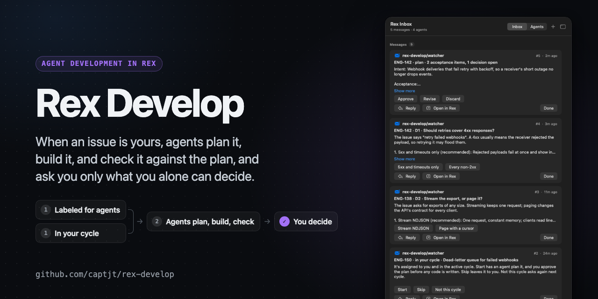
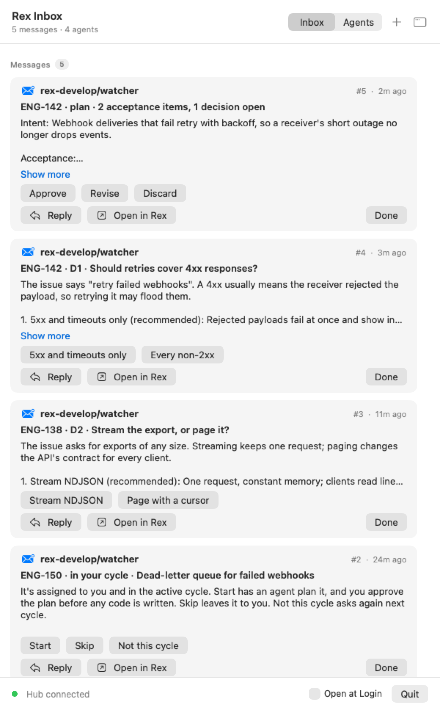
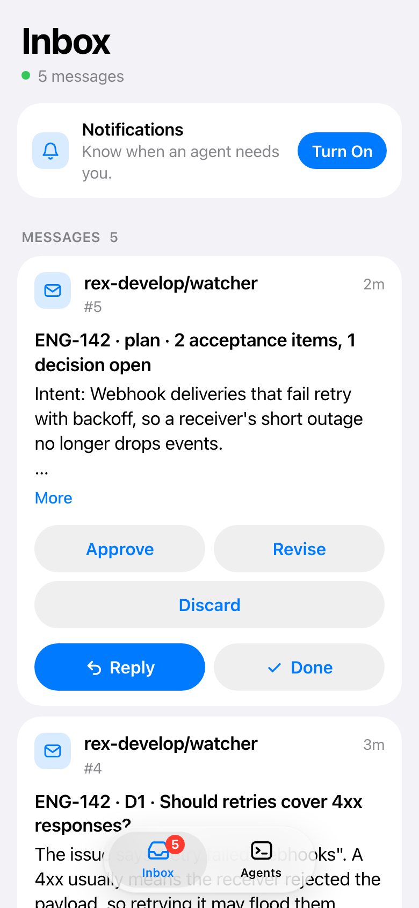

# rex-develop



Agent development for the issues assigned to you, run in
[Rex](https://www.superlogical.com/rex). When an issue in your tracker is
yours to build (labeled for agents, or in your active cycle), a builder
agent plans it and builds it, a checker agent checks the work against the
plan, and the PR opens from your account with the plan attached. You
approve the plan and the PR, and you answer the decisions only you can
make. With [rex-inbox](https://github.com/captjt/rex-inbox), each of those
reaches you as a message with buttons, on your Mac or your phone.

It's the other half of [rex-reviewer](https://github.com/captjt/rex-reviewer),
which reviews the PRs that request you. rex-develop builds the ones you
author.

```
Linear issue ─▶ plan ─▶ build ─▶ check ─▶ preview ─▶ open PR, with the plan
                 │        │                   │          │
                 └── decisions and approvals: rex-inbox messages ──┘
```

It runs on your machine, in your Rex session, with your own agents. The
watcher does the bookkeeping and spends no tokens. Nothing writes to your
tracker.

> Rex is in private beta. rex-develop needs a Rex build whose agents report
> program status: Claude Code and Codex do on their own.

## How a task works

1. **The issue.** The watcher checks your tracker every few minutes. An
   issue assigned to you, in an unstarted state (Todo), that has the
   `agent` label starts on its own. One in your active cycle without the
   label is offered first: **Start**, **Skip**, or **Not this cycle**.
2. **Prep.** It makes a worktree on the issue's own branch (Linear's
   `branchName`, which links the PR back to the issue), and writes the
   issue, its comments, and related issues into `.tmp/context/`, so the
   agents never call your tracker or GitHub.
3. **The plan.** The builder reads the issue and writes a plan: what it set
   out to do, the acceptance items with how each is shown, what's out of
   scope, and the decisions it can't make alone. Each decision is a
   question with options and a recommendation. You get the plan with
   **Approve**, **Revise**, or **Discard**, and each decision as its own
   message. If the issue can't be built as written, you get **Not ready**
   instead.
4. **The build.** The builder implements the plan, follows your answers,
   runs the repo's checks, and commits. It never pushes.
5. **The check.** A checker, a fresh agent and by default a different one,
   checks the branch against the plan and the decisions, and runs the
   checks again. What it finds goes back to the builder, up to `fix_loops`
   times.
6. **The preview.** When the change is something you can see, the builder
   serves it and you get **Looks right** or **Needs work**. Through
   rex-inbox, it opens on your phone.
7. **The PR.** You get the PR's title and body with **Open PR**, **Needs
   changes**, or **Discard**. Open PR pushes the branch and opens the PR as
   a draft, with `Closes ENG-142`, the plan, and a footer that names the
   agents:

   ```markdown
   ---

   <div align="right"><sub><i>Claude Code (Opus 5.5) on behalf of @you · checked by Codex (GPT-6.1-Sol) · rex-develop</i></sub></div>
   ```

8. **The end.** When the PR merges, its worktree and local branch go.

## Decisions

A decision is a question the issue, the code, and the repo's conventions
don't settle, where a wrong guess costs real rework or changes what people
see: product behavior, an API or schema shape, a migration, scope, a new
dependency, a security or privacy stance. The briefs tell the agents to make
the conventional choice for everything else, and to note it.

The builder raises one by writing a file. The watcher sends it to you:

```
ENG-142 · D1 · Should retries cover 4xx responses?

The issue says "retry failed webhooks". A 4xx usually means the receiver
rejected the payload, so retrying it may flood them.

1. 5xx and timeouts only (recommended): rejected payloads fail at once…
2. Every non-2xx: simpler, but a bad payload is sent 5 times.

Meanwhile: building with 5xx and timeouts only.

[5xx and timeouts only]  [Every non-2xx]
```

Answer with a button, a button and a note ("but cap it at 3"), or your own
words. The builder keeps going on its recommendation while it waits, unless
building either way would waste the work. Approving the plan accepts the
recommendation for any decision you haven't answered. The PR's plan records
who decided each one, or that the recommendation stood.
[`docs/decisions.md`](docs/decisions.md) has the file format.

## The plan on the PR

The plan is the PR's evidence of intent. It goes at the end of the PR body
between markers, so reviewers, and tools such as rex-reviewer, can check
the change against what it set out to do:

```markdown
<!-- rex-develop:plan v1 ENG-142 -->
<details open><summary><b>Plan</b> · ENG-142 · approved by @you</summary>

**Intent.** Webhook deliveries that fail now retry with backoff…

**Acceptance**
- A delivery that gets a 5xx or times out retries up to 5 times: `retry::backs_off`.

**Decisions**
- **D1 · Should retries cover 4xx responses?** 5xx and timeouts only. Chosen by @you.

**Out of scope**
- A dead-letter queue (ENG-150).

</details>
<!-- /rex-develop:plan -->
```

For a public repo whose issues live in a private tracker, the plan goes out
in summary, in the builder's own words, without quoting the issue. Set a
repo's `plan` to `full`, `summary`, or `false` to choose.

## Requirements

- macOS, and Rex
- [LuaJIT](https://luajit.org) (`brew install luajit`), `git`, `jq`, and
  `curl`
- [`gh`](https://cli.github.com), signed in as you
- A builder and a checker: [Claude Code](https://claude.com/claude-code) or
  [Codex](https://github.com/openai/codex), in any mix
- For Linear, a personal API key with read access
- Optional: [rex-inbox](https://github.com/captjt/rex-inbox) with answer
  options on messages, for decisions and approvals on your Mac and phone

## Install

```sh
git clone https://github.com/captjt/rex-develop ~/src/rex-develop
ln -s ~/src/rex-develop/bin/rex-develop ~/.local/bin/rex-develop   # any folder on your PATH
rex-develop setup            # creates ~/.config/rex-develop/config.lua
rex-develop setup-linear     # stores your Linear key in the Keychain
rex-develop doctor           # checks the config, the tools, the repos, and Linear
rex-develop up               # starts the watcher in the rex-develop Rex session
```

The watcher runs as LuaJIT in an ordinary Rex pane, so it uses your shell's
git and gh sign-ins and needs nothing loaded into Rex. `init.lua` registers
the actions in Rex too, if you want `rex do develop_answer …` for key
bindings.

## Configure

The config is a Lua file that returns a table.
[`examples/config.lua`](examples/config.lua) shows every option.

```lua
return {
  trackers = {
    linear = { label = "agent", cycle = true, teams = { ENG = "acme/api" } },
    -- github = { label = "agent" },
  },
  repos = {
    ["acme/api"] = { checkout = "~/src/api", notes = "Run `make test`." },
  },
  builder = "claude",
  checker = "codex",
  gates = { start = { label = "auto", cycle = "ask" }, plan = "ask", preview = "ask", open = "ask" },
}
```

- **Trackers.** Linear and GitHub Issues. A Linear team maps to a repo, or
  to several (the issue's label picks one, or you're asked); a project can
  override its team. GitHub has no cycles, so only the label starts work
  there. `rex-develop start ENG-142` takes any issue by hand.
- **Gates.** Each approval is `ask` (it waits for you) or `auto`.
- **Guides.** `plan`, `build`, `check`, `pr_style`, and `plan_format` point
  the agents at your own skills or instructions: a path, a string,
  `"bundled"`, or `false`. Copy a brief from [`briefs/`](briefs) to
  `~/.config/rex-develop/briefs/` to change it.

## What the agents can do

- Each task gets its own worktree on its own branch. The builder commits
  there; the checker only reads and runs things.
- They never push. `gh` is signed out, there's no Linear key or SSH agent,
  git's credential helpers are cleared, every push URL is rewritten to one
  that can't work, and Claude Code's deny rules block `git push` and `gh`.
  Only the watcher pushes, after you approve, and only a fast-forward of the
  task's own branch, at the head the checker passed.
- `.tmp/` in the worktree is rex-develop's, and git there ignores it. The
  watcher refuses to open a PR whose commits include it.
- It never merges, resolves threads, closes issues, or writes to your
  tracker.

## Day to day

```sh
rex-develop status                       # every task, and what needs you
rex-develop ls                           # what waits on you
rex-develop answer ENG-142 plan Approve
rex-develop answer ENG-142 D1 2 "but cap it at 3"
rex-develop answer ENG-142 plan --text "split out the migration"
rex-develop start ENG-142 | discard ENG-142 | focus ENG-142
rex-develop pause | resume | check | up | down
```

### With rex-inbox

While the rex-inbox hub runs, every ask goes to you as a message from the
watcher's pane, with its answers as buttons, and your reply is the answer.

<table>
  <tr>
    <td valign="top">
      <picture>
        <source media="(prefers-color-scheme: dark)" srcset="docs/images/inbox-dark.png">
        
      </picture>
    </td>
    <td valign="top">
      <picture>
        <source media="(prefers-color-scheme: dark)" srcset="docs/images/phone-dark.png">
        
      </picture>
    </td>
  </tr>
</table>

<sub>The issues are made up. <code>scripts/screenshots.sh</code> renders these again from a made-up world.</sub>

A reply that comes after the ask moved on gets told so, and changes
nothing. Without rex-inbox, the asks show as program status on the
watcher's tab in Rex, and `rex-develop ls` and `answer` do the rest.

rex-inbox needs answer options on messages, and must let a tool's pane
message you as itself. An older rex-inbox still works: the answers are
listed in the message, and you reply in words.

## Build on it

Everything lives in plain files under `~/.local/state/rex-develop/`.
[`docs/ledger.md`](docs/ledger.md) is the contract.

```
bin/                    rex-develop, rex-agent
scripts/                the watcher and the CLI, under LuaJIT; the screenshots
lua/rex_develop/        config, ledger, rules, trackers, tasks, decisions, plan, inbox, agents, watcher, actions
briefs/                 the prompts: ground rules, plan, build, check
guides/                 the plan's format and the PR's style
tests/                  luajit tests/*.lua; tests/e2e.sh in Rex
docs/                   the ledger, decisions, and the images
```

## Tests

```sh
for t in tests/{rules,decisions,plan,trackers}.lua; do luajit $t; done
tests/e2e.sh                 # in Rex, against a made-up Linear and stand-in agents
INBOX=1 REX_INBOX_BIN=… tests/e2e.sh   # the same, reaching "you" through a rex-inbox hub of its own
```

The end-to-end test runs a real watcher in a Rex session of its own, with a
stand-in agent, a fake Linear, a stand-in `gh`, and a local bare repo as
origin. It spends no tokens and touches nothing of yours.

## Limits

- macOS only.
- Round 1 only, for now: the PR opens, and reviews on it are yours to
  answer. Addressing reviews, CI fixes, and rebases come next (see
  [DESIGN.md](DESIGN.md)).
- Previews from an app need rex-inbox to open on a phone, and that app must
  allow `.ts.net` hosts.

## License

MIT. See [LICENSE](LICENSE).
